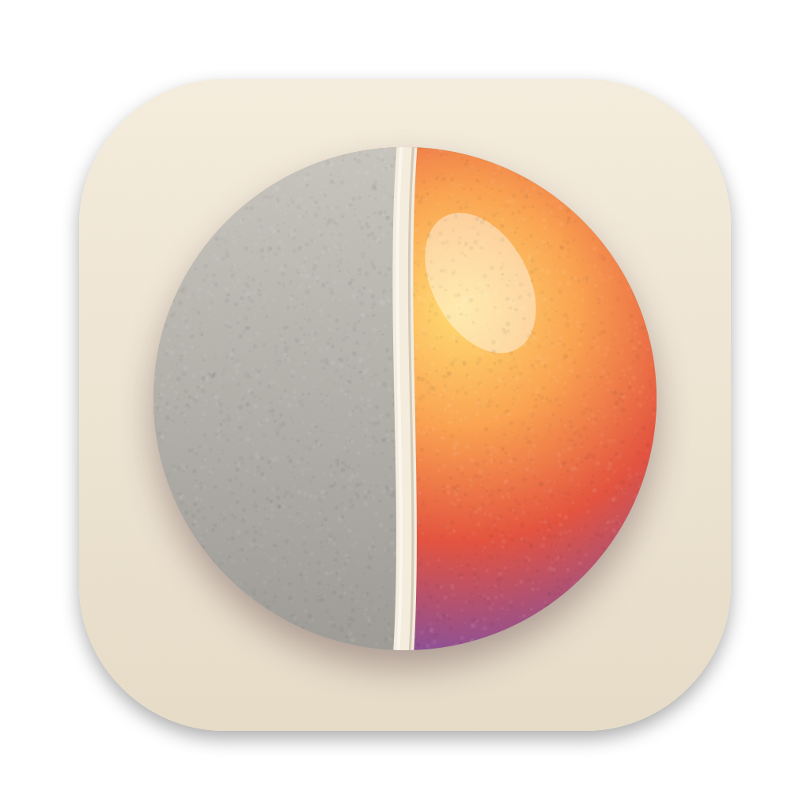
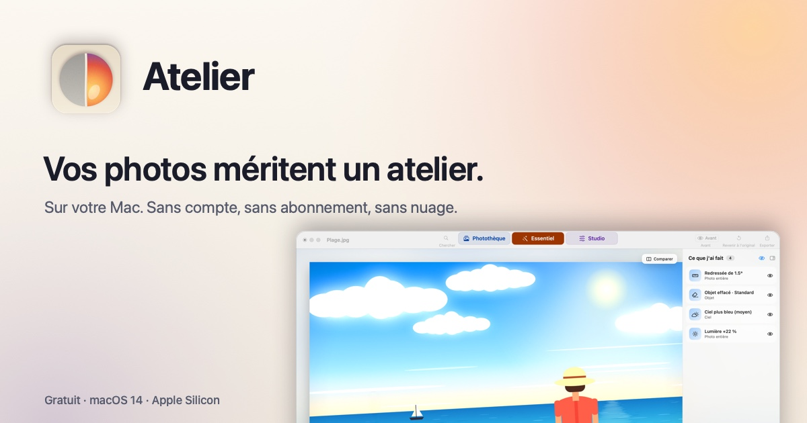

<h1 align="center">Atelier</h1>

<b>Vos photos méritent un atelier.</b> · <b>Your photos deserve a studio.</b> 
Sur Mac, Windows et Linux. Sans compte, sans abonnement, sans nuage. · On Mac, Windows and Linux. No account, no subscription, no cloud.

<a href="https://github.com/xavier38/atelier/releases/latest/download/Atelier.zip"><b>⬇︎ Télécharger / Download Atelier.zip</b></a> ·
<a href="https://github.com/xavier38/atelier/releases/latest/download/Atelier-Windows-x86_64.zip">Windows (préversion)</a> ·
<a href="https://github.com/xavier38/atelier/releases/latest/download/Atelier-Linux-amd64.deb">Linux (.deb, préversion)</a> ·
<a href="https://xavier38.github.io/atelier/">Site</a> ·
<a href="https://xavier38.github.io/atelier/installation.html">Installation</a> ·
<a href="https://xavier38.github.io/atelier/confidentialite.html">Confidentialité / Privacy</a>

Mac : gratuit · macOS 14 Sonoma ou plus récent · Apple Silicon. Windows/Linux : préversions 0.1.0 ; validation Linux Mint en attente. — Mac: free · macOS 14 Sonoma or later · Apple Silicon. Windows/Linux: 0.1.0 previews; Linux Mint validation pending.

## 🇫🇷 En deux mots

Atelier réunit trois modules pour organiser et retoucher vos images :

- **Photothèque** : parcourez vos dossiers et les photos d’Apple autorisées, créez ou renommez des dossiers, déplacez les images par glisser-déposer avec une cible bien visible, ou mettez-les à la corbeille.
- **Essentiel** : cliquez sur ce qui vous gêne (ciel, personne, arrière-plan, objet). Atelier a repéré les zones de la photo sur votre Mac et propose trois variantes calculées sur votre image, puis un curseur. Suggestions (penchée, un peu sombre, sujet détecté), journal « Ce que j'ai fait » où chaque ligne se masque, se modifie ou se retire, Espace pour voir l'original, Revenir à l'original toujours possible.
- **Studio** : l'éditeur complet. 50+ effets, 19+ outils (pinceau, correcteur, pièce, tampon, formes, texte, recadrage, perspective, fluidité…), calques de réglage, masques, filtres modifiables, styles, groupes, écrêtage, modes de fusion, histogramme, RAW.

Tout est **non destructif** : ce que l'Essentiel fait apparaît en couches dans le Studio, et le document Atelier garde la photo d'origine, le journal et les calques. Export par destination (message, en ligne, impression, qualité maximale) ou à la main : PNG, JPEG, HEIC, AVIF, TIFF, BMP, GIF, TGA, ICO, DDS, JPEG 2000 ; lecture WebP, JPEG XL, PSD, RAW.

**Vie privée** : tout se passe sur l'appareil. Aucune photo ne quitte votre Mac, aucun compte, aucune statistique, aucune publicité. Mises à jour automatiques (une vérification par jour, désactivable). Mode clair et sombre, 7 langues.

## 🇬🇧 In short

Atelier brings together three modules to organise and edit your images:

- **Photo Library**: browse your folders and authorised Apple Photos, create or rename folders, move images by drag and drop with a clearly highlighted target, or send them to the Trash.
- **Essential**: click what bothers you (sky, person, background, object). Atelier has found the areas of the photo on your Mac and offers three variants computed on your picture, then a slider. Suggestions (tilted, a bit dark, subject detected), a “What I did” list where each line can be hidden, changed or removed, Space to see the original, Back to original always possible.
- **Studio**: the full editor. 50+ effects, 19+ tools (brush, healing, patch, clone, shapes, text, crop, perspective, liquify…), adjustment layers, masks, editable filters, styles, groups, clipping, blend modes, histogram, RAW.

Everything is **non-destructive**: what Essentiel does shows up as layers in the Studio, and the Atelier document keeps the original photo, the list and the layers. Export by destination (message, online, print, maximum quality) or by hand: PNG, JPEG, HEIC, AVIF, TIFF, BMP, GIF, TGA, ICO, DDS, JPEG 2000; reads WebP, JPEG XL, PSD, RAW.

**Privacy**: everything happens on the device. No photo ever leaves your Mac, no account, no analytics, no ads. Automatic updates (one check a day, can be turned off). Light and dark mode, 7 languages.

Aussi en / also in: español, português, Nederlands, Deutsch, italiano.

Ce dépôt ne contient que le site. · This repository only holds the website.
